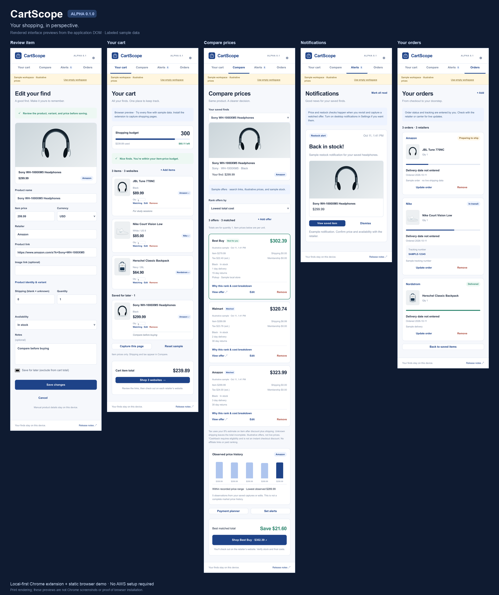

# CartScope · Alpha 0.1.1

We built CartScope for the moment when a shopping trip turns into a dozen open tabs. It keeps products from different stores in one Chrome side panel, lets you compare the costs of offers you've checked, and keeps your budget and order notes beside them.

The Alpha is published on Kartik's personal GitHub account. It works with product details you capture or enter yourself. Automatic retailer search, continuous price checks, and live shipment updates are still planned. We also still need ten consenting reference users and their feedback; the invitation below is a draft.

- [Source — qarteu/cartscope](https://github.com/qarteu/cartscope)
- [Download Alpha 0.1.1 and read the release notes](https://github.com/qarteu/cartscope/releases/tag/v0.1.1)
- [Open the browser demo](https://qarteu.github.io/cartscope/)
- [Submission attachments](docs/SUBMISSION.md)
- [Sprint board](docs/SPRINT_BOARD.md) · [GitHub issues](https://github.com/qarteu/cartscope/issues)
- [Give feedback](https://github.com/qarteu/cartscope/issues/new?template=alpha-feedback.yml)



*Actual Chrome screenshots using labeled sample data. [Screenshot sources and test details](docs/visuals/README.md).*

## Install in Chrome

1. Download **cartscope-alpha-0.1.1.zip** from the [release page](https://github.com/qarteu/cartscope/releases/tag/v0.1.1). Choose the release asset rather than GitHub's source-code ZIP.
2. Unzip it into a folder you'll keep. The folder must contain `manifest.json` directly.
3. Open `chrome://extensions`, enable **Developer mode**, and select **Load unpacked**.
4. Choose that unzipped folder. Pin CartScope from Chrome's Extensions menu.
5. Open a retailer product page and click the CartScope toolbar icon. In the side panel, choose **Capture this page** and review the result before saving.

Use Chrome 116 or newer. Keep the unzipped folder in place while the extension is installed. To remove it, select **Remove** on its card at `chrome://extensions`.

For development, load the repository's `extension/` folder. After changing code, select **Reload** on the extension card and reopen the panel. The extension does not need a build step or an AWS account.

## What you can do

**Save a product.** Capture its page, then check the name, price, retailer, model, variant, and condition. Correct any missing or inaccurate details. The image comes from the page or a placeholder; manual entry is available when capture fails.

**Plan a purchase.** Keep finds from several stores in one cart. Change quantities, add notes, save items for later, and set an item-price budget. Shipping and tax are shown separately in Compare. Shopping links take you back to the retailer to check final costs and complete checkout.

**Compare offers you've checked.** Add another store's offer for the same model, size, color, and condition. Compare price, shipping, estimated tax, membership costs, verified discounts, and eligible cashback. You can rank by total cost, delivery, pickup, or returns when those details are available. Missing required costs stay unknown. Checkout determines the actual amount charged.

**Watch a price or restock.** Set a watch, then revisit and capture the same offer or update it manually. CartScope checks the new observation against the previous one and records a qualifying change. Optional desktop notifications need Chrome permission. It does not check stores while you're away.

**Keep order notes.** After buying from a retailer, enter the order's status, dates, tracking number, tracking link, and notes. Update them as information arrives. These are your records; they aren't connected to a carrier feed.

**Check installment arithmetic.** Enter the purchase amount, payment count, interest amount, fees, first date, and interval. The calculator shows the full obligation and payment schedule, with a stated late fee separately. Confirm the provider's actual terms and due dates; the calculator does not quote APR or offer credit.

**Back up your data.** Settings lets you export a JSON backup, import one, or delete the workspace. Historical alerts aren't replayed after import. The sample workspace stays separate from your real cart.

## Try it without installing

The [browser demo](https://qarteu.github.io/cartscope/) uses the same interface with labeled example products, prices, stock, and orders. You can edit them, add manual entries, compare offers, and try the calculator. Changes stay in that browser's local storage and are separate from the installed extension.

Page capture and Chrome desktop notifications require the extension. A fresh extension installation starts with an empty real cart; samples are optional.

To run the demo locally:

```sh
npm run demo
```

Open the URL printed by the server. [Demo setup](docs/DEMO.md) covers static hosting.

## What still needs work

The [verification record](docs/VERIFICATION.md) documents automated checks of the packaged extension and browser demo in Chrome. Those checks use product-page fixtures. Current retailer markup, manual installation on testers' operating systems, and native desktop notification delivery still need field testing.

Automatic cross-store discovery, unattended price checks, carrier updates, provider-backed financing, and account synchronization are on the [sprint board](docs/SPRINT_BOARD.md). They are not included as live integrations in this Alpha.

Recruiting ten reference users, sending their invitations, and collecting their responses are also pending. We will update the tracker when those actions happen.

## Privacy and permissions

Shopping records stay in Chrome's local extension storage, or browser local storage in the demo. There is no shopping-data server, analytics service, account, or payment storage. Loading product images and opening retailer links makes normal requests to those sites. Backups include your products, notes, and order records, so store them somewhere appropriate.

- **activeTab + scripting:** capture the selected page after you click the toolbar icon and request capture.
- **storage:** retain your records on this device.
- **sidePanel:** open the shopping panel beside the page.
- **notifications, optional:** display an alert after an observed watched change.

CartScope requests no blanket host permission. Capture cannot read Chrome's internal pages and may fail on protected or restricted pages. Manual entry remains available.

## Reference-user feedback

Use the [Alpha feedback form](https://github.com/qarteu/cartscope/issues/new?template=alpha-feedback.yml) to report task completion, time taken, 1–5 ratings, and written comments. Tell us which step confused you, what information was missing, and what you would change first. Failed or blocked tasks help us identify bugs.

The [test protocol](docs/FEEDBACK_PLAN.md) defines the tasks and rating scales. Reference users use an assigned ID from R01 through R10. Keep names, addresses, payment details, and personal order numbers out of public issues. Testers without GitHub accounts can reply privately to the team using the same questions.

[The invitation template](docs/ALPHA_EMAIL.md) is ready to personalize. [The roster](docs/REFERENCE_USERS.csv) contains unassigned slots, not completed invitations or test results.

## Develop and package

Use Node.js 22 or newer for development and tests. The extension runtime has no third-party dependencies; DOM and browser tests use development dependencies.

```sh
npm ci
npm run validate
npm test
npm run package
```

For Chrome tests:

```sh
npx playwright install chromium
npm run test:browser
```

Validation checks the manifest, referenced files, permissions, and version consistency. Packaging creates `artifacts/cartscope-alpha-0.1.1.zip` and its SHA-256 file, with `manifest.json` at the archive root. File order and ZIP timestamps are fixed so unchanged runtime files produce the same archive. [Verification](docs/VERIFICATION.md) records the actual test coverage.

For release, commit the source, run the checks, create tag `v0.1.1`, and publish the runtime ZIP, checksum, and [release notes](CHANGELOG.md). Follow the [release checklist](docs/RELEASE_CHECKLIST.md) and update the tracker with the resulting evidence.

## Team

Kartik Malunjkar is our System Architect and Release Train Engineer. Jake Clevenger is Product Manager and Product Owner. Eashan is Business Owner and Scrum Coach. Participant contacts and delivery evidence stay in the team's private records.

Source is available under the [MIT license](LICENSE).
